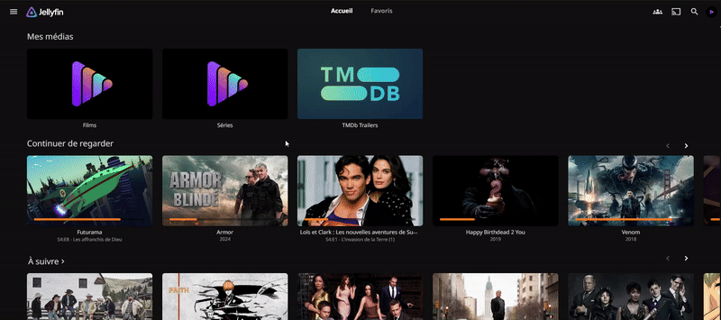
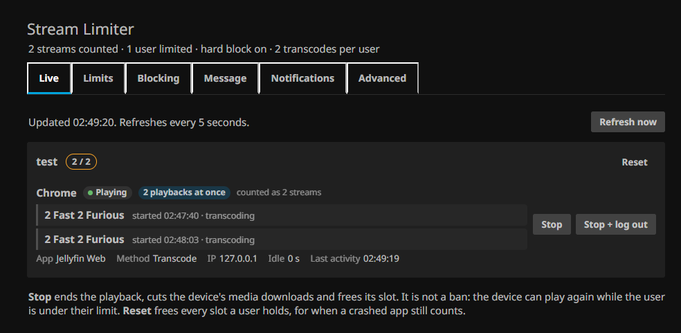
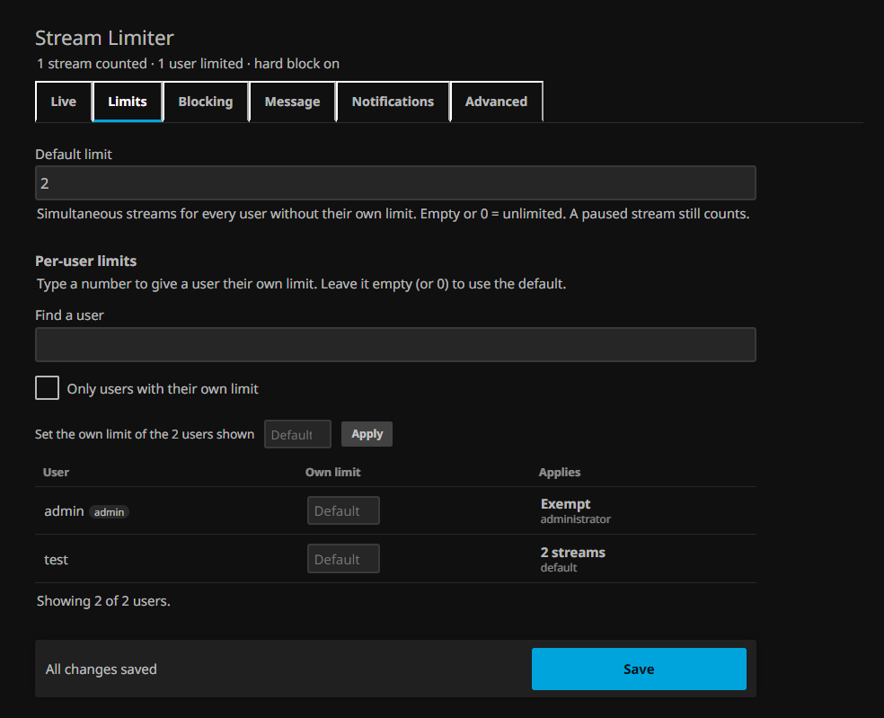
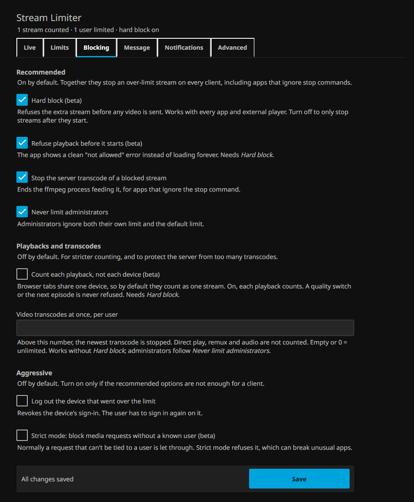
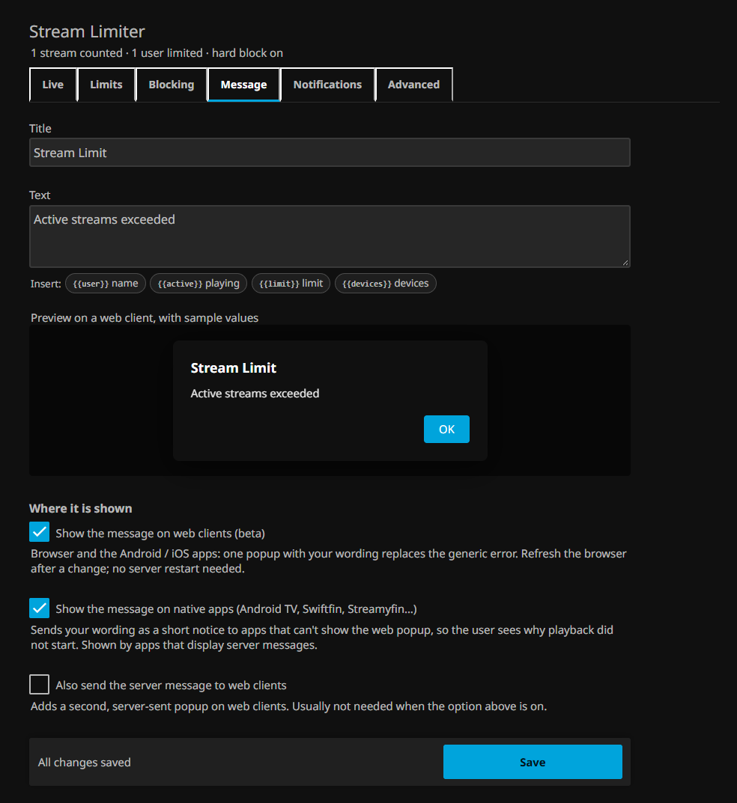
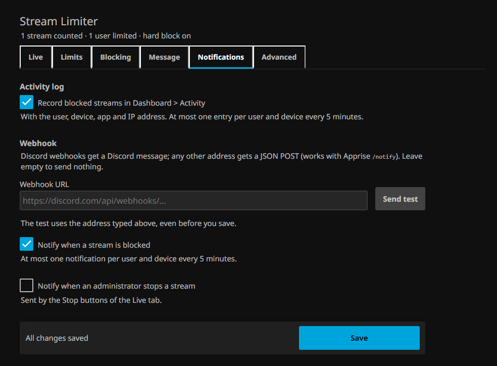
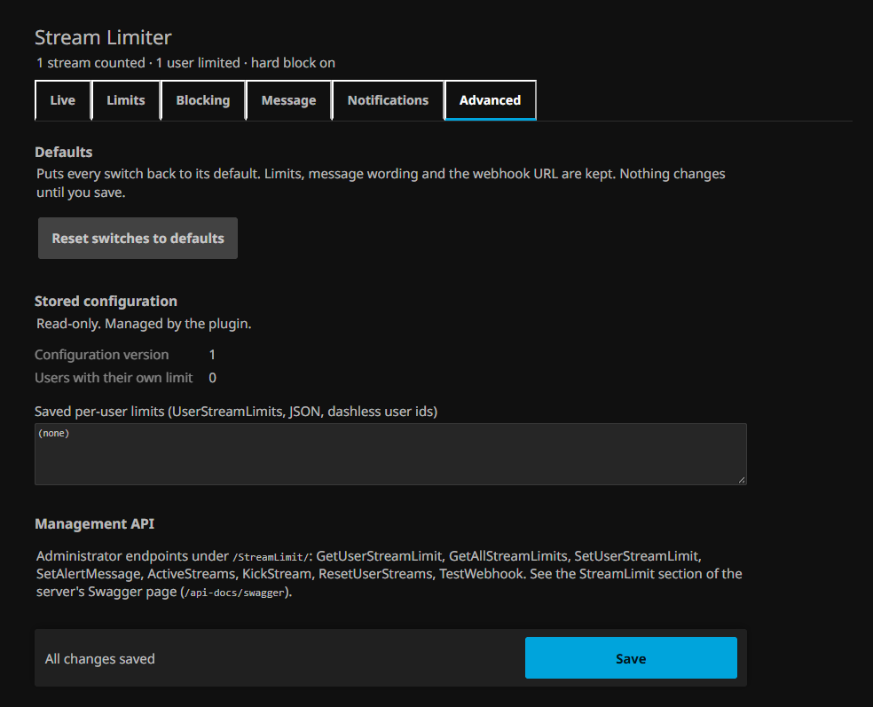

# Jellyfin Stream Limiter Plugin


Limit the number of simultaneous streams per user on your Jellyfin server — with a hard block that works on **every** client.

## Compatibility

| Jellyfin server | Plugin version | Build |
|---|---|---|
| **10.11.0 → 10.11.x** | `1.1.0.x` | `net9.0` |
| **12.0 → 12.x** (tested up to 12.4) | `1.1.1.x` | `net10.0` |

One manifest serves both: your server installs the right build automatically. Same features on both lines.

> ⚠️ **BETA** — the HTTP-level hard block and the custom web message (v1.1+) ship enabled by default. Each can be turned off in the settings to fall back to the classic behaviour.

## Installation

1. **Dashboard → Plugins → Repositories → +**, and add:
   ```
   https://raw.githubusercontent.com/JellyboxAD/Jellyfin.Plugin.StreamLimit/main/manifest.json
   ```
2. **Catalog → Stream Limiter → Install**, then restart Jellyfin.
3. **Dashboard → Stream Limiter** (sidebar entry) or **Dashboard → My Plugins → Stream Limiter** to set your limits.

Installing from the repository is recommended: you get automatic updates and the plugin logo. A manual install (zip from the [releases](../../releases) extracted into the server's `plugins` folder) works too, but has no logo and no auto-update.

## Features

- 🎮 **Per-user limits**, plus a **default limit** for everyone else
- 👑 **Administrators exempt** by default (can be turned off)
- 🚧 **Hard block at the HTTP level** *(BETA)*: media requests over the limit get `403` before a single byte is served. A stream that is never served cannot be played, whatever the client (native apps, Infuse, external players, custom apps).
- 🗂️ **Count each playback, not each device** *(BETA, opt-in)*: browser tabs share one device id, so by default they count as one stream; this counts each of them
- 🔥 **Video transcode limit per user** *(opt-in)*: caps how many video transcodes one account runs at once, so it cannot saturate the server's encoder
- 🙅 **Clean refusal at setup** *(BETA)*: `PlaybackInfo` answers "playback not allowed", so clients fail before loading instead of spinning
- 💬 **Your own message on web clients** *(BETA)*: one popup with your title/text instead of the generic dialog, in every language — with placeholders such as `{{devices}}` (where the user is already watching)
- 📺 **Live view**: see exactly the streams that count (and why), stop one (optionally logging the device out) or reset a user's streams
- 📱 **Message on native apps**: Android TV, Swiftfin, Streamyfin, AFinity, Findroid… get your message as a notice instead of an endless spinner
- 🔔 **Webhook notifications**: Discord, Apprise or any JSON endpoint when a stream is blocked
- 🛑 **Reactive safety net**: stop command → server-side transcode kill → optional device logout
- 👻 **No ghost lockouts**: streams count by real activity (Jellyfin playback reports, bytes actually sent), not by open connections; a crashed client that stopped reporting playback frees its slot after 3 minutes, and a client that keeps its session alive after being stopped no longer counts
- 📋 **Activity log**: every blocked stream appears in *Dashboard → Activity* with user, device, client and IP
- 🧹 **Clean-up**: a deleted user's limit is removed from the configuration
- 🔁 **Automatic migration** of pre-1.1 configurations
- 🔒 **Admin-only management API**

## Example



## Configuration

Defaults are safe: install, set a limit, done. The settings page (**Dashboard → Stream Limiter**) has six tabs; changes are saved with the **Save** bar at the bottom, which also tells you when something is not saved yet.

### Live



- Exactly the streams the plugin counts against the limit, per user and device — client, item, play method, IP, last activity, idle time — plus the devices the plugin just stopped. Refreshes every 5 seconds while the page is open.
- Each stream says why it counts: **playing** (Jellyfin reports playback), **streaming** (a media response sent bytes in the last 90 s), **recent** (a media request in the last 60 s, e.g. HLS between segments). **Stopped** marks a device the plugin stopped whose client still keeps its session alive: shown, not counted.
- **Several playbacks on one device** (typically browser tabs, which share one device and one Jellyfin session) are listed one by one under the device, with their title, start time and whether they transcode, so two tabs read as two simultaneous streams. They count once per device, or once each with *Count each playback*; a refused playback stays listed, marked with the rule that refused it, while its client is still trying.
- Open connections that send nothing are not counted and not listed (their number is shown as *open responses* on the streams that are). They are cut after 30 minutes without a byte.
- Exempt administrators only appear when their client reports playback (they bypass the HTTP gate, so they hold no slot).
- **Stop** sends a stop command (a server-side stop for clients that can't receive it), kills its transcode, cuts the device's media downloads still in progress and frees its slot immediately; **Stop + log out** also logs the device out. Both are recorded in *Dashboard → Activity*. A stop is not a ban: the device can start again if the user is under their limit.
- **Reset** (per user) is the last-resort fix when a user is counted with streams they don't have: it releases all of the user's slots (cutting their open media responses) and forgets the devices the plugin stopped, so only what Jellyfin really reports counts again.

### Limits



- **Per-user limit**: pick a user and set their max simultaneous streams. Empty or `0` removes the entry (the default applies).
- **Default limit**: applies to every user without an explicit limit. `0` = unlimited.
- A paused stream still counts while its client keeps reporting playback to Jellyfin (most clients do, every few seconds). A media connection left open without sending anything (phone asleep, network lost, app killed) does not.
- Administrators are not limited while *Never limit administrators* is on (default); the table shows which limit applies to each user and why.
- **Set the own limit of the users shown** applies one value to every user matching the search, in one go.

### Blocking



| Option | Default | What it does |
|---|---|---|
| **Recommended** | | |
| Hard block *(BETA)* | on | Rejects over-limit media requests at the HTTP level, before any byte is served. Off = classic stop-command behaviour only. |
| Refuse playback before it starts *(BETA)* | on | Denies the stream during setup (`PlaybackInfo`). Requires the hard block. |
| Stop the server transcode of a blocked stream | on | Stops the server-side ffmpeg job of a blocked stream. |
| Never limit administrators | on | Administrators are never limited, whatever their own or the default limit. |
| **Playbacks and transcodes** | | |
| Count each playback, not each device *(BETA)* | off | Each playback counts (several browser tabs, or clients sending a copied device id), not just each device. A quality switch or the next episode is never refused. Requires the hard block. |
| Video transcodes at once, per user | 0 (unlimited) | Above this number, the newest video transcode is stopped (ffmpeg job killed, its requests refused). Direct play, remux and audio are not counted. Works without the hard block. |
| **Aggressive** | | |
| Log out the device that went over the limit | off | Revokes the device token. Most aggressive: the user must sign in again on that device. |
| Strict mode *(BETA)* | off | Also rejects media requests whose user cannot be identified. Off = those are let through (fail-open). |

### Message



- **Title / Text**: your wording, shown when a stream is blocked. Placeholders, in both:

  | Placeholder | Replaced with |
  |---|---|
  | `{{user}}` | the user's name |
  | `{{active}}` | the streams already playing (the blocked one not included) |
  | `{{limit}}` | the user's limit |
  | `{{devices}}` | the other devices playing, comma-separated |

  Example: `{{user}}, you are already watching on {{devices}} ({{active}}/{{limit}}).` Placeholders are case-insensitive; unknown ones are left as typed. They apply to the web popup and to the server message. The chips under the text insert them, and the preview shows the popup with sample values as you type.
- **Show my message on web clients** *(BETA, on)*: replaces the web client's "not allowed" dialog with your popup (browser, Android app, iOS app). **No server restart needed**: turning it on/off or changing the title/text only needs a browser refresh. Works with read-only web folders (Docker, distro packages).
- **Show my message on native apps** *(on)*: sends your title/text as a Jellyfin server message (`DisplayMessage`, shown for 10 s) to the blocked device when its app is native (Android TV, Swiftfin, Streamyfin, AFinity, Findroid, Jellyfin Media Player, Kodi…): those apps cannot show the web popup and would otherwise only show an error or an endless spinner. When the jellyfin-android app's native player is blocked, the message goes to the app's web UI instead (the player itself cannot receive it). At most one message per user and device every 30 s. Whether and how a native app displays it is up to the app.
- **Also send the server message to web clients** *(off, advanced)*: web-based clients (browser, Android and iOS apps) already show your popup; this adds the server message on top, as a second dialog.

### Notifications



| Option | Default | What it does |
|---|---|---|
| Record blocked streams in the activity log | on | Adds a *Dashboard → Activity* entry per block (user, device, client, IP), at most one per user and device every 5 minutes. |
| Webhook URL | empty (off) | Discord webhook (`https://discord.com/api/webhooks/…`) → a Discord message. Any other `http(s)` URL → a JSON `POST` (below), which the Apprise API `/notify` endpoint accepts as-is. Only `http(s)` URLs are accepted (the settings page refuses others; one sent anyway is ignored on save and the previous URL kept). **Send test** posts a test event to the URL typed in the field. |
| Notify when a stream is blocked | on | At most one notification per user and device every 5 minutes. |
| Notify when an administrator stops a stream | off | Sent by the *Stop* buttons of the live view. |

Generic JSON body (`event` is `stream_blocked`, `admin_kick` or `test`):

```json
{ "title": "Stream blocked", "body": "alice was blocked from streaming on TV (limit 2, 2 already playing).",
  "type": "info", "event": "stream_blocked", "user": "alice", "userId": "<dashless-id>",
  "device": "TV", "deviceId": "<device-id>", "client": "Jellyfin Web", "ip": "192.168.1.20",
  "active": 2, "limit": 2, "server": "<server name>", "timestamp": "2026-10-25T12:30:00.000Z" }
```

Webhooks are sent in the background with a 10 s timeout; failures are only logged (with the host, never the full URL). Payloads never contain access tokens.

### Advanced



- **Reset switches to defaults** puts every switch back to its default; limits, message wording and the webhook URL are kept, and nothing changes until you save.
- **Stored configuration** shows, read-only, the configuration version and the saved per-user limits (JSON with dashless user ids), handy for support.
- **Management API** lists the admin endpoints (see [API](#api)).

> **Upgrading from 1.0.x?** Nothing to do: on first start the plugin migrates your configuration (legacy dashed user ids and corrupted entries are cleaned automatically).
>
> **Upgrading to 1.1.0.2 / 1.1.1.2?** Administrators are now exempt by default — turn *Never limit administrators* off if your limits must apply to admins too.

## Client behaviour

Every client is blocked by the hard block. What the user *sees* depends on the app — no server plugin can change a native app's UI.

| Client | What the user sees when blocked |
|---|---|
| Jellyfin Web (browser) | Your custom popup |
| Jellyfin Android / iOS apps | Your custom popup (web UI); when the native Android player is blocked, your message waits in the app's web UI |
| Jellyfin Android TV | "Playback not allowed" toast, then your server message as a toast |
| Swiftfin | Closes the player on the initial `403` (generic error); ignores server messages |
| Streamyfin | "Failed to get the stream URL", or an endless loader with the mpv engine |
| AFinity | An error message |
| Infuse / external players | Their own playback error |

Downloaded/offline items play from the device and cannot be blocked by the server.

## How it works

**Hard block.** A global request filter inside the Jellyfin server matches every media request (progressive `stream`, HLS playlists and segments, universal audio, Live TV, `/Items/{id}/File` and `/Download`) to a playback *slot* per user and device:

- a device already streaming keeps its slot (item switches, quality changes and seeks are not new streams);
- a new device beyond the limit gets **`403`** with the resolved message in its JSON body (`{"Message": "…"}`) and an `X-StreamLimit: 1` header — no media bytes are ever served;
- `PlaybackInfo` returns `ErrorCode: NotAllowed` at the limit;
- every block response also carries the resolved title and text in `X-StreamLimit-Title` / `X-StreamLimit-Message` (percent-encoded UTF-8), exposed to cross-origin web clients via `Access-Control-Expose-Headers`;
- a device counts only while it shows real activity: Jellyfin reports it playing (check-in within 3 minutes), one of its media responses sent bytes within 90 s, or it made a media request within 60 s. A response that stays open without sending anything (half-open connection after the phone slept or lost its network, a paused progressive transcode, a server-side segment wait the client gave up on) stops counting after 90 s; if it starts sending again it counts again; after 30 minutes without a byte it is cut;
- slots free up when the client reports a stop (unless a response is still sending), when its session ends, or after 60 s without activity; idle slots of a user about to be blocked are freed after 15 s; a clean-up runs every minute;
- theme songs and backdrop videos played while browsing never hold a slot;
- requests that cannot be attributed to a user (API keys, anonymous) are never blocked, unless strict mode is on.

**Playbacks and transcodes (opt-in).** Browser tabs share one device id, and Jellyfin merges them into a single session, but each playback still carries its own `PlaySessionId` in its media URLs (requests without one are keyed by device and item). With *Count each playback* on, every further live playback of a device counts as one more stream; with a transcode limit set, the plugin counts the user's playbacks that have a running ffmpeg job that does not copy the video (looked up through Jellyfin's transcode manager by `PlaySessionId`; a request without one is never counted as a transcode, a stream is never refused on a guess). A playback is live while it made a media request in the last 15 s or one of its responses sent bytes in the last 90 s. When a rule is exceeded, the **newest** playback is refused as soon as the overlap is confirmed: it is at least 5 s old and an older playback still made a media request after it started (or a direct-play download is still sending 8 s after it started). A quality switch or the next episode never confirms an overlap, since the old playback stops fetching the moment the new one starts, so it is never refused. In practice a second browser tab is refused within about 5 to 10 s. A refused playback gets `403` on its next request, its open responses are cut, its transcode is killed and it no longer holds a device slot; after 30 s it is checked again, so a client that keeps retrying plays again as soon as the user has freed a stream; the user, the activity log and the webhook are told as for any block, and the web popup stops the refused tab at once (it pauses the video and closes the player) instead of letting it play what it had already downloaded. It is checked on each media request, 6, 10 and 20 s after a playback starts (direct play makes no further request) and every minute.

**Web message.** The plugin adds a `<script>` tag to the web client's `index.html` *as it is served* (a small middleware, compatible with a server BaseUrl). Nothing is written to the web folder, so it works with read-only installs and survives web updates; the setting is read on every page load, so toggling it needs no restart. Versions up to 1.1.0.1 wrote the tag into `index.html` on disk: it is removed automatically at startup (and on uninstall). The script detects a block (`X-StreamLimit` header or `PlaybackInfo` error, over both XHR and `fetch`), shows one popup with your title/text above the buffering spinner and hides the client's own error dialog. If anything goes wrong, the page is served unchanged and the client simply shows its built-in dialog — the block itself is never affected.

**Reactive safety net.** When a playback start still goes over the limit, the plugin stops the newest stream: stop command (plus a server-side stop when the client cannot receive commands) → transcode kill → server message (native apps) → optional device logout. It counts one stream per device, and only sessions that reported playback in the last 3 minutes, so a crashed client can't get your new stream killed. A stopped device is then left out of the count for up to 10 minutes — until it reports a stop, its session ends or it is allowed to play again — because some clients keep reporting progress after being stopped (AFinity), never report the stop (Swiftfin on error) or cannot receive the stop command (jellyfin-android's native player).

## Troubleshooting

| Symptom | Cause / fix |
|---|---|
| Plugin disabled, log says *"references an incompatible version of one of the shared libraries"* | Fixed in `1.1.0.1` (issue #19): update the plugin and restart. |
| Plugin logo missing on Jellyfin 12, disable/uninstall buttons fail | Fixed in `1.1.1.1`: update the plugin and restart. |
| No logo after a manual install | Expected: Jellyfin only downloads the logo when installing from the repository. |
| Custom web message not shown | Check that *Show my message on web clients* is on, then refresh the browser (hard reload). The server log says `web message script added to the web client` on the first page load. |
| Limits don't apply to an admin account | Expected while *Never limit administrators* is on (default). |
| Limit not applied | Check the user's effective limit with `GET /StreamLimit/GetUserStreamLimit?userId=<id>` and the server log (entries from `Jellyfin.Plugin.StreamLimit`). |

## API

Management endpoints require **admin** permissions:

```http
GET  /StreamLimit/GetUserStreamLimit?userId=<id>
     → { "userId": "<dashless-id>", "streamsAllowed": <effective, 0 = unlimited or exempt admin>, "explicitLimit": <n|null> }
GET  /StreamLimit/GetAllStreamLimits
     → { "defaultMaxStreams": <n>, "limits": { "<dashless-id>": <n>, ... } }
POST /StreamLimit/SetUserStreamLimit?userId=<id>&streamsAllowed=<n>
     → sets the user's limit; 0 removes it (the default applies again)
POST /StreamLimit/SetAlertMessage?alertMessage=<text>&title=<title>
     → updates the blocked-message wording
GET  /StreamLimit/ActiveStreams
     → [ { "userId", "userName", "limit", "exempt",
           "streams": [ { "deviceId", "deviceName", "client", "itemName",
                          "playMethod": "DirectPlay|DirectStream|Transcode|unknown",
                          "remoteEndPoint", "sessionId", "lastActivity": "<ISO UTC>",
                          "source": "session|slot|both", "enforced": <bool>,
                          "counted": <bool>, "reason": "playing|streaming|recent|stopped",
                          "idleSeconds": <n>, "openResponses": <n> } ] } ]
     → only what is counted, plus the devices the plugin stopped ("reason": "stopped", "counted": false)
POST /StreamLimit/KickStream?userId=<id>&deviceId=<device-id>&logout=false
     → { "stopped": <sessions stopped>, "aborted": <live media responses cut>, "stale": <ended registrations cleared>,
         "released": <slot freed>, "loggedOut": <bool> }
POST /StreamLimit/ResetUserStreams?userId=<id>
     → { "released": <slots released>, "aborted": <live media responses cut> }; also clears the user's stopped devices
POST /StreamLimit/TestWebhook[?url=<url>]
     → { "ok": <2xx>, "status": <http status|null>, "error": <text|null> }; 400 without a valid http(s) URL
```

One endpoint is anonymous by design (loaded by the web client before login, contains no secrets):

```http
GET  /StreamLimit/inject.js    → the web-message client script
```

User ids are accepted with or without dashes. Swagger UI: `http://your-server/api-docs/swagger` (StreamLimit section).

## Development

```bash
# Jellyfin 10.11 build
dotnet publish Jellyfin.Plugin.StreamLimit/Jellyfin.Plugin.StreamLimit.csproj -c Release -o publish/net9

# Jellyfin 12 build
dotnet publish Jellyfin.Plugin.StreamLimit/Jellyfin.Plugin.StreamLimit.csproj -c Release \
  -p:PluginTargetFramework=net10.0 -p:JellyfinVersion=12.0.0 -o publish/net10

# Tests (add the same -p: flags to test the Jellyfin 12 build)
dotnet test tests/Jellyfin.Plugin.StreamLimit.Tests/Jellyfin.Plugin.StreamLimit.Tests.csproj
```

The plugin has no external dependencies, so each release zip contains a single DLL.

Two rules keep every server able to load the plugin (both are checked by tests):

- **Build against the first release of a Jellyfin line** (`10.11.0`, `12.0.0`), never a floating `10.11.*` and never a later 12.x (every 12.x minor bumps the assembly version). The DLL records the Jellyfin versions it was compiled against, and an older server refuses a plugin that asks for a newer version (issue #19).
- **The DLL version must match the manifest version** of its build (`1.1.0.x` for 10.11, `1.1.1.x` for Jellyfin 12, both set in `Directory.Build.props`). Jellyfin uses it to build the logo and plugin-management URLs.

### Releasing

1. Bump both versions in `Directory.Build.props` and add a `### [vX.Y.Z.W]` section at the top of the changelog in `build.yaml`.
2. Optional: write the GitHub release description in `.github/release-notes/vX.Y.Z.W.md` (otherwise it is generated from the changelog).
3. Commit, then push a tag: `git tag v1.1.0.2 && git push origin main v1.1.0.2`.

The release workflow then runs the tests on both builds, builds both zips, creates the GitHub release and adds the two new versions (with their checksums) to `manifest.json` on `main`. Editing a file in `.github/release-notes/` later and pushing it updates that release's description.

## Contributing

1. Fork the project
2. Create a feature branch (`git checkout -b feature/AmazingFeature`)
3. Commit your changes (`git commit -m 'Add some AmazingFeature'`)
4. Push to the branch (`git push origin feature/AmazingFeature`)
5. Open a Pull Request

## License

MIT — see [LICENSE](LICENSE).

## Support

Check the [issues](../../issues) or open a new one.
